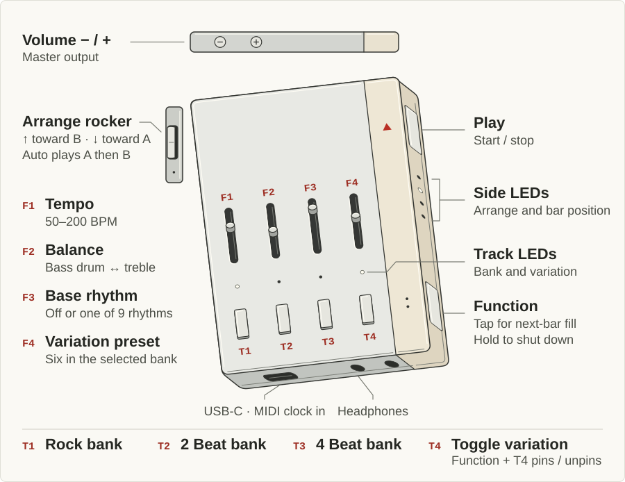

# SP-66

A Roland TR-66 Rhythm Arranger recreation for the Teenage Engineering SP-1.
The C engine synthesizes the drum voices at 48 kHz and plays all 27 factory
rhythms. The SP-1 firmware sends the mono mix to the onboard headphone and speaker
codecs. The firmware uses no samples.

## Hear it on your computer

```sh
make test render
work/build/tr66-render work/sp-66-demo.wav bossa-nova rock-6 auto 120 4
```

This renders four bars of Bossa Nova layered with Rock 6, alternating between
the A and B phrases at 120 BPM, with one second for the final hits to ring out.[^reports]

## SP-1 controls

[](docs/sp1-controls.svg)

| Control | Action |
| --- | --- |
| Fader 1 | Tempo from 50 to 200 BPM |
| Fader 2 | Balance between bass drum and hi-hat/maracas/cymbal, with the TR-66's shunt response approximated and unity gain at center |
| Fader 3 | Off, Waltz, Jazz Waltz, Slow Rock, Bossa Nova, Samba, Mambo, Cha-Cha, Beguine, Rhumba |
| Fader 4 | Six presets within the current variation bank |
| T1, T2, T3 | Select Rock, 2 Beat, or 4 Beat |
| T4 | Tap to toggle the selected variation. Hold Function and tap T4 to pin or unpin the rhythm under Fader 3 |
| Arrange rocker | Press down toward A or up toward B, one position at a time through A, Auto, and B |
| Play | Start or stop |
| Function | Tap for one fill on the next bar while playing, hold for about two seconds for shutdown |
| Volume buttons | Master output level |
| Track LEDs | Selected variation bank. T4 shows whether the variation is on, or whether the current rhythm is pinned while Function is held |
| Side LEDs | Arrange setting and current bar |
| USB-C | [MIDI clock and transport input](#usb-midi-clock) |
| Headphones | Audio output |

The original score uses two bars per A or B phrase. Auto plays A then B.
Some rhythms add a pickup on the first downbeat of the full Arrange cycle.
Jazz Waltz adds a snare every two bars in B and every four bars in Auto.
The Function fill is an SP-1 addition and plays the last bar of B once.
Rhythm, variation and Arrange changes take effect on the next downbeat.
Slow Rock is in 6/8. The tempo fader still sets the quarter-note rate.

To play Roland's Waltz and Mambo example, set Fader 3 to Waltz, hold
Function and tap T4, then release both buttons and move Fader 3 to Mambo.
Pin additional rhythms the same way. To hear only the pinned rhythms, move
Fader 3 to Off. To clear all pins, hold Function and tap T4 while Fader 3
is at Off. Waltz, Jazz Waltz and Slow Rock put every active layer on the
shared triple-time counter. See the
[Roland player's manual](https://cdn.roland.com/assets/media/pdf/TR-66_OM.pdf#page=10).

```sh
work/build/tr66-render work/waltz-mambo.wav waltz+mambo off a 120 4
```

For Roland's Beguine example on the same page, set Fader 3 to Beguine,
turn the variation off with T4, and set Arrange to B. Beguine supplies
the extra bongo hits in every second bar.

## Build and reproduce

Host tests and renders use a C11 compiler. The capture and comparison scripts
use Python with NumPy, SciPy and SoundFile.

```sh
make test render all
python3 tools/fetch_references.py
work/build/tr66-render work/sp-66-demo.wav bossa-nova rock-6 auto 120 4 work/bossa-rock6-auto.csv
python3 tools/compare_groove.py work/sp-66-demo.wav work/bossa-rock6-auto.csv work/tr66-groove-ab.wav
python3 tools/calibrate.py --output work/fitted-patches.inc --report work/fit.json --audition work/isolated-ab.wav
```

The calibration script renders each patch in isolation with the engine's C
voice renderer. The full groove renderer also applies cross-trigger effects,
such as the low-bongo ring excited by the snare.
Its proposed coefficient table goes in `work/` for review before it replaces
`src/voice_patches.inc`. The firmware build needs only the coefficients.

The current comparison uses [Crypton Drumbase 5000](https://archive.org/details/drumbase-5k.7z).
Extract the two TR-66 directories from Partition D into
`work/references/complete/drumbase`. The archived 7z has SHA-1
`c80b26e6a5edd5997091ea257c2ae62d298b9467`. Keep the recordings in the host
reference directory. Re-run the comparison with the checked-in coefficients.

```sh
python3 tools/compare_recordings.py --report work/recordings.json --audition work/recordings-ab.wav
```

To repeat the initial fit, run `tools/calibrate.py` with
`--drumbase 'work/references/complete/drumbase/Partition D/15. TR-66 #2'`,
build with that candidate table, then run `tools/compare_recordings.py` with
`--fit-gains work/mix-patches.inc`. The mix fit calls the C engine for each voice,
then fits one set of voice levels across the training loops. It retains the
isolated rim level because the Bossa Nova loop is held out. The final
refinement fits shared voice levels to 11 CD loops and six Reverb loops.
The [recording report](outputs/tr66-recording-fit.json) gives those gains and
the later ring-down measurements used in the current coefficient table.

The second comparison uses the Roland Rhythm Arranger pack from
[Reverb Drum Machines](https://archive.org/details/reverb-drum-machines-complete-collection).
Extract that pack to `work/references/complete/reverb` and run the comparison.

```sh
python3 tools/compare_reverb.py --report work/reverb.json --audition work/reverb-ab.wav
```

[Goldbaby's TapeTR66](https://www.goldbaby.co.nz/freestuff.html)
provides another set of isolated hits. The pack's notes identify `aOrig`
files as direct recordings into a Metric Halo ULN-2. Use those takes for
voice checks alongside the loop packs. The archive contains 113 one-shots,
including the tape variants, and seven REX loops.

Both comparisons accept `--baseline` with an earlier renderer. Add
`--baseline-slow-rock-scale 1` when that renderer already takes Slow Rock
tempo in quarter notes per minute.

The host renderer defaults to centered Balance. Set `TR66_RENDER_BALANCE`
between −1 (bass) and +1 (treble) to compare at a fixed position.

```sh
TR66_RENDER_BALANCE=0.3198 python3 tools/compare_reverb.py --report work/reverb-balanced.json --audition work/reverb-balanced.wav
```

For SP-1, use Zephyr 4.3.1, the SDK 0.17.4 ARM toolchain, and the `cmsis`,
`cmsis_6` and `hal_nordic` modules pinned by the Zephyr manifest. From a
configured west workspace, with the Zephyr Python dependencies and DTC
available, set `tr66_project` to this project directory and run:

```sh
west build -b stem_player -d "$tr66_project/work/sp1-build" "$tr66_project/firmware" -- -DBOARD_ROOT="$tr66_project/firmware"
```

The development image is `work/sp1-build/zephyr/tr66-sp1.bin`, linked at
`0x20000` for the SP-1 application slot. Board and codec sources are credited
in [firmware/NOTICE](firmware/NOTICE). The build exposes startup and runtime
diagnostics over USB serial and in a RAM struct for SWD inspection. See the
hardware status below before flashing.
The community flashing path uses [Solderless](https://solderless.engineering/utility/).
With the SP-1 off, hold Track 1 and Track 4 while connecting USB-C in Chrome
or Edge, then release when the Track 1 light comes on. Connect in the
utility and select the SP-1 `.bin`. Flashing replaces the factory application.
Treat replacing the factory firmware as one-way. See the
[SP-1 installation notes](https://learn.adafruit.com/hacking-the-teenage-engineering-sp-1/install-circuitpython).

The host engine rendered 5,103 passes across all supported selections and
Arrange settings at 50, 120 and 200 BPM, with Balance centered and at both
ends. The loudest sample was 0.531 of digital full scale, with zero clipped samples.

## USB MIDI clock

Connect the SP-1 over USB-C to a DAW or a USB MIDI host. Enable MIDI Clock
and transport send to the **SP-66** MIDI port, then start the host. SP-66
follows the host at 24 pulses per quarter note. MIDI Start plays the first
step on the next clock, Stop holds the current place, and Continue resumes
on the next clock. A Song Position Pointer sent while stopped seeks to that
sixteenth-note position in the selected rhythm on Continue.

For a host that sends only clock, press Play while clocks are arriving to
start at the next pulse. Play can also stop the rhythm locally. The tempo
fader sets the tempo for standalone play. If the clock is silent for half a
second, the rhythm stops and Play can start standalone again.

## Hardware status and diagnostics

The first hardware test of commit `8c8792a` completed the bootloader's write
and finalization steps, but left Track 1 lit with no response to Function.
Follow-up hardware diagnostics reached the running audio loop, then reproduced
control scanning stuck inside an ADC read. Audio and USB continued running;
the original Function handling depended on those stalled scans.

Control reads now use the asynchronous ADC API with a 10 ms deadline. If a
conversion stalls, the firmware aborts it, waits up to another 10 ms for the
driver to release the request, discards that scan and continues. It resets
if the abort cannot complete, rather than reusing a buffer still owned by
DMA. Hardware testing has exercised this recovery repeatedly while control
scanning and audio rendering continued. The reason the peripheral sometimes
fails to complete a conversion remains under investigation; this is a
recovery workaround, not a claim that the underlying ADC fault is fixed.

In a roughly three-minute SP-1 test on 2026-11-07, the recovery build completed
14,327 control scans and rendered 129,030 audio blocks. Eleven ADC stalls
recovered without a reboot; no render-budget overruns or I2S write errors
were recorded. Sound, buttons, faders and Function shutdown were checked on
the device. Shutdown reached stage 9 and extinguished the LEDs with USB
connected. This is a short functional test, not an extended stability run.

The development firmware presents MIDI and a diagnostic serial interface
under **SP-66**. Open its serial port at 115200 baud with DTR asserted for
one status line per second. The device starts independently of the host
connection. Each line reports startup and failure stages, status code,
control-scan attempts, last ADC result, audio blocks queued for I2S, peak
render cycles, over-budget blocks, I2S write errors, Function state, and
the nRF reset flags observed on app entry. The `usb` value reports the
composite device initialization result. The line also shows the scan
phase, six raw ADC values, and cumulative ADC timeouts. The `saadc` field
holds ENABLE, END, STARTED and RESULT.AMOUNT from the most recent timeout.
Observed stalls had `saadc=1,0,0,0`. Sending lowercase `r` on the diagnostic
console restarts the device. A fatal error records its reason and program
counter in uninitialized RAM before resetting. Retention of that record
across the bootloader still needs verification.

| Stage | Last startup milestone |
| --- | --- |
| 1 | Initializing the synthesis engine |
| 2 | Initializing controls and LEDs |
| 3 | Attempting codec power-on and I2S startup |
| 4 | I2S primed and waiting for codec configuration |
| 5 | Codecs ready; control scanning scheduled |
| 6 | Stopping background work |
| 8 | Startup or audio error; awaiting Function shutdown |
| 9 | Shutdown idle loop |

Scan phases 10–15 identify the ADC input being read (track buttons, side
buttons, then faders 1–4). Phase 20 is input decoding, 30–37 an LED update,
40 LEDs updated, 50 jack detection, and 60–61 scheduling the next scan.

The side LED nearest Function lights during app startup, so it is
distinguishable from the bootloader's solid Track 1 LED. The audio loop
stops waiting after 2.5 seconds for codec setup or 500 ms without a
successful I2S write after setup. Either timeout reports `-110`. On
failure the side row flashes, the codecs are powered down, charging
resumes, and the serial console and Function shutdown remain available.
The shutdown sequence disables the I2S peripheral before cutting its
external clocks, following [Wakes](https://github.com/Worldwave/Wakes).

A separate thread reads Function directly from its GPIO, independently of
ADC scans and audio startup. After the button has been released once since
boot, a roughly two-second hold requests shutdown; continuing to four
seconds resets the device if shutdown has stalled. Fatal errors reset
instead of halting. The build also enables stack protection, assertions,
and a four-second watchdog where the bootloader has not already started one.
ADC oversampling is applied after devicetree sequence initialization so it
is no longer overwritten.

The independent Function reset and watchdog have been exercised on hardware.
To re-enter the bootloader, shut down with Function, disconnect USB, then
hold Track 1 and Track 4 while reconnecting USB. A reset with USB continuously
connected may restart the application instead. Devices still running the
original frozen image must first regain the bootloader through a power cycle.

## Notes from Codex on Fidelity

The [Roland player's manual](https://cdn.roland.com/assets/media/pdf/TR-66_OM.pdf)
contains all 27 scores on PDF pages 6–8. Figures 10 and 13–18 of the
[service notes](https://archive.org/details/roland-tr-66-service-notes)
show the voice circuit and timing. Hi-hat and maracas share one voice.
Bossa Nova and Rock 2/3 use a reduced-amplitude bass drum on some offbeats.
Both recording sets confirm the quiet high bongo in Beguine, plus reduced
conga and high-bongo triggers and a softer B-fill kick in Rhumba.
Both packs also have a softer kick on beat 3 of the second Slow Rock B bar.
It measures 41% of a nearby full kick on the CD and 49% in Reverb. Some CD
kick attacks clip. The service charts also helped correct Slow Rock's
timing, several Rock B fills, Habanera, Swing 1, Parade and the Mambo B fill.

The CD includes one-shots and 23 captures with sampler loop points.
Its one-shots supplied most of the voice fits. On separated Beguine hits,
the low bongo's 30–95 ms ring measures about 394 Hz and a 19 ms decay
constant on the CD, and 405 Hz and 51 ms in Reverb. Roland provides a
separate decay trim for this voice in section 10-3-2-3 of the service notes.
The C model uses a fast 7.5 ms mode and a 36 ms free ring at 400 Hz.
Figure 1 and section 10-3-3-3 show the snare feeding the same low-bongo
circuit through a diode and resistor. The snare drives the free ring
with a weaker, phase-shifted pulse. The C model adds the two pulses
when snare and low bongo coincide. A recording of that combination
would verify the combined drive.

Rhumba's full bass drum and low bongo share a trigger row in Figure 13.
That row drives the bongo's existing resonators with a fitted pulse.
On three clean full hits in held-out Reverb Rhumba B, the 259–339 Hz
energy moved from 19 dB above the original to within 0.2 dB. The Drumbase
attacks clip. Across seven of their tails, the 348–467 Hz waveform
correlation went from −0.89 to 0.96. With one Arrange cycle of warm-up,
Reverb Rhumba A and B loop errors fell from 3.56 to 3.21 dB and
from 3.54 to 3.26 dB respectively.

Six repeated kick waveforms in each Reverb Rhumba loop confirm the
124.457 BPM loop-length clock. The measured alignment brings RMS kick
lag below 0.17 ms in both phrases. The Reverb comparison applies the
fractional offset in the frequency domain to retain the recorded treble.
The C model's 5–14 ms bongo attack is 1.07 dB above the extrapolated free
ring in the 285–538 Hz band, up from 0.77 dB. The Reverb median is 1.14 dB
and the Goldbaby Rumba median is 2.37 dB. The model increases the drive to
the existing 7.5 ms ring and offsets its onset with the short pulse.

The direct low bongo's polarity follows the recorded Beguine attacks.
On five clean Reverb Beguine B hits with high conga and low bongo, the
255–342 Hz attack was 10.9 dB above the recording relative to the
352–458 Hz body. The polarity correction brings that excess to 0.9 dB.
After one Arrange cycle at fitted Balance, the loop error falls from
3.67 to 3.53 dB for Reverb Beguine B and from 2.82 to 2.77 dB for the
Drumbase Beguine.

The two extra low-bongo hits in Beguine B use 110% long-ring drive and
48% short-ring drive with a small phase shift. Across the four captured
hits, RMS ring-level error relative to the regular hits falls from
0.89 to 0.34 dB. Error in the 9–17 ms attack relative to the ring falls
from 0.89 to 0.28 dB. The high conga on the first fill hit rings at
86–91% of the regular conga level in both captures, and the model uses
88% drive. Reverb B fill-window error falls from 3.32 to 2.94 dB and
full-loop error from 3.35 to 3.31 dB. The clean Drumbase fill-window
error rises from 2.37 to 2.45 dB, with a 0.005 dB rise across the loop.

The quiet kick and low-bongo hit in the Rhumba B fill drives the bongo
with the opposite polarity from Beguine's direct hit. With the recordings
aligned by the kick, the 347–469 Hz waveform correlation from 10 to 54 ms
after the hit rises from −0.93 to 0.92 on Reverb and from −0.91 to
0.92 on Drumbase. The full-loop spectral error rises by 0.01 dB and 0.02 dB
respectively.

The snare attack has a short pulse followed by a slower, opposite-polarity
recovery. Cowbell hits from Mambo and Cha-Cha measure about 893 Hz in Reverb
and 897 Hz on the CD. The model uses 895 Hz.
The snare attack and tone changes improved several groove scores. In that
pass, isolated 35–540 Hz waveform correlation fell from 0.95 to 0.94 on
Drumbase and from 0.92 to 0.86 on Reverb.

A 0.33 ms decay shapes the snare's leading edge. On nine isolated hits held
out of that fit, with the snare body level matched, the median 1.12–2 kHz
attack error fell from about 6 dB to within 0.9 dB in both recording sets.
After one Arrange cycle, the Drumbase Habanera A loop error fell from
2.98 to 2.85 dB and Reverb Habanera A fell from 2.96 to 2.89 dB.

The high bongo uses Roland's 600 Hz service setting and two decays at that
frequency. The 32 ms mode carries more of the body of the hit. On three
isolated hits from the [Vintage Synth Explorer demo](https://www.vintagesynth.com/roland/tr-66),
the envelope error fell from 0.39 to 0.11 dB. With one Arrange cycle of
warm-up at the fitted Balance, Reverb Mambo B fell from 3.42 to 3.37 dB.
Drumbase Samba rose from 2.53 to 2.56 dB. The two loop packs still differ
in how long the bongos ring.

Figures 13 and 16 put Samba's cowbell and high bongo on the same
trigger. Across ten Samba hits in Drumbase and Reverb, the fitted bell
decay is 16.7–17.1 ms. Comparable Mambo hits measure 13.4–13.5 ms.
The C engine uses a 16.9 ms bell decay and a softer bongo ring on the
shared pulse. Settled Samba loop error falls from 2.50 to 2.13 dB in
Drumbase B and from 2.49 to 2.42 dB in Reverb A.

The Samba bongo attacks are nearly level across the five steps. The
two stronger hits ring about 1 dB above the two weaker ones after
roughly 26 ms. The C engine uses two short decays to cancel the added
or reduced long ring at the onset of each hit. Across seven windows
from 5 to 93 ms, the error in level relative to the opening hit falls
from 0.44 to 0.09 dB RMS across Drumbase B and Reverb A. The full-loop
scores move by less than 0.01 dB from the shared-pulse model.

Beguine's quiet high-bongo trigger has its own resistor path in Figure 13.
The C model drives the short 600 Hz mode more softly relative to the ring.
In the 530–680 Hz band from 4 to 14 ms, the quiet hit moves from 14.0 to
15.5 dB below the full hit. The Drumbase and Reverb measurements are
15.6 and 15.1 dB below the full hit. From 32 to 60 ms, both recordings
and the revised render are about 14 dB below.

Drumbase and Reverb Rhumba have the same three high-bongo ring levels.
The C model drives the short and long 600 Hz modes independently at the
corresponding steps.
Across 40 clean hits, RMS error in relative ring levels from 24 to 75 ms
falls from 1.23 to 0.34 dB. Error in the 7–19 ms attack relative to the
ring falls from 1.08 to 0.51 dB. The Goldbaby Mambo and Rumba REX files
yielded noise-level estimates for the high-bongo ring.

The two extra high-bongo hits in the Mambo B fill at ticks 12 and 84 ring
3.6–4.1 dB above the regular hit in Drumbase and Reverb. The C model
raises their long mode and reduces their short attack mode. Error in
relative ring level falls from 3.94 to 0.20 dB RMS across the four hits.
The attack fit uses the clean Reverb hits because the Drumbase attacks clip.
After one Arrange cycle of warm-up, the loop error moves from 3.15 to
3.01 dB in Reverb Mambo B and from 2.65 to 2.68 dB in the unclipped
Drumbase windows.

On Mambo's coincident cowbell and low-bongo hit, the C engine increases
the low bongo's short ring drive by half and offsets the added onset
with the pulse mode. Across eight clean hits from Drumbase, Reverb and
Goldbaby, the median error in the 7–17 ms ring relative to the 24–44 ms
body falls from 0.66 to 0.28 dB. Full-loop error changes by at most
0.014 dB across the four Mambo captures.

The high conga adds a short 200 Hz decay alongside its longer ring.
This strengthens the initial cycles and brings the ratio of the first
trough to the first crest from 0.577 to 0.674. In 14 separated loop hits,
the corresponding median ratios are 0.680 in Drumbase and 0.662 in
Reverb. After one Arrange cycle at the fitted Balance, Drumbase Cha-Cha
improves from 2.78 to 2.63 dB and Reverb Beguine B from 4.27 to 4.12 dB.
At center Balance, Drumbase Beguine rises from 3.03 to 3.11 dB.

The high conga also has a faint second harmonic. At 12 ms it is about
47 dB below the fundamental in a clean Drumbase Mambo hit and 46 dB below
in Reverb. Goldbaby's direct `CongaLo_aOrig` takes measure 50–51 dB below
and show a similar relative phase after correcting recording polarity.
The C render measures 46.6 dB below. The harmonic decays twice as fast as
the fundamental and scales with the square of the hit drive. Across all
48 Drumbase and Reverb loops, the spectral score shifts by less than
0.006 dB.

After matching cowbell levels, the high-conga ring in Cha-Cha is
2.8–3.1 dB below the same hit in Mambo across Drumbase, Reverb, and
Goldbaby. Cha-Cha uses 71% conga drive in both phrases. The relative
ring-level error falls from 2.96 to 0.11 dB RMS across the three sources.
The settled Cha-Cha loop errors fall from 2.47 to 2.39 dB in Drumbase,
2.58 to 2.23 dB in Reverb, and 5.68 to 5.30 dB in Goldbaby.
In the clean 24–82 ms conga windows, Drumbase error in the 125–235 Hz
band rises from 1.06 to 1.81 dB.

Fitting the high conga ring 25–88 ms after the trigger gives about 30 ms
in Goldbaby's loops, 46 ms in Drumbase and 79 ms in Reverb. Goldbaby's
direct `CongaLo_aOrig` takes contain the 202 Hz conga. Its
`CongaHi_aOrig` takes contain the 865 Hz bell. Setting the C decay to
29 ms lowers the Goldbaby Mambo loop error from 4.01 to 3.02 dB and raises
the Reverb Mambo B error from 3.14 to 7.75 dB. The factory patch keeps the
58 ms decay. In Mambo, the 200 Hz ring continues through the next
low-bongo hit. Immediately before that hit the Reverb tail is about
10 dB above the model and the Drumbase tail about 6.5 dB below it,
relative to each source's conga drive.

Both recording sets have a brief low-frequency pulse under cymbal and
hi-hat hits. The hi-hat uses two decays of opposite sign. The cymbal uses
three to model the slower negative undershoot seen in both packs.
From 18 to 35 ms after an isolated cymbal hit, the 15–125 Hz level is
−19.6 dB relative to the treble in Drumbase Slow Rock and −29.9 dB in
Reverb's held-out Slow Rock B and Jazz Waltz B hits. The C render moves
from −35.7 to −27.8 dB on Drumbase and from −35.1 to −27.5 dB on those
Reverb hits. The full settled Slow Rock loop moves from 2.01 to 1.91 dB
of spectral error in Drumbase, from 2.11 to 2.09 dB in Reverb A, and from
2.16 to 2.15 dB in Reverb B.

The snare uses a held decay and a free decay to approximate the two
capacitor paths into the noise gate in Figure 10. The gate rises with a
0.81 ms time constant, holds its main branch for about 42 ms, and closes
near 95 ms. A short counter-pulse softens the initial broadband edge.
Across 13 Drumbase and 23 Reverb snare-only hits, the median 2.2–14.5 kHz
level from 2 to 4 ms is now within 0.6 dB of each recording relative to
the 7–30 ms body. The previous error was 2.9–3.1 dB. In the first 2 ms,
the errors fall from 6.3 to 2.0 dB in Drumbase and from 3.9 to 0.2 dB in
Reverb. The 2–4 ms level also comes within 1.2 dB of Goldbaby's five
direct hits.

Reverb's snare has about 8 dB more noise relative to its tonal ring than
Drumbase's. The firmware uses a shared setting between the two. At fitted
Balance after one Arrange cycle, the Habanera A spectral error falls from
2.88 to 2.83 dB in Reverb and rises from 2.85 to 2.91 dB in Drumbase. The
[Drum Abuse one-shots](https://github.com/smpldsnds/drum-abuse-vol1/tree/58a9b6246d232d862fad15e06c97a4a030655017/samples/roland-tr-66)
show a similarly quick rise. Two snare noise waveforms match hits in
[Vintage Synth Explorer's demo](https://www.vintagesynth.com/roland/tr-66)
at 0.92 and 0.97 normalized correlation, so those matches count as one source.

The rim shot now uses a short deterministic pulse to drive a 1.525 kHz
resonator with a 2.10 ms decay. Figure 10 shows a passive resonator and
trigger pulse. The two loop packs give rim decays of about 2.09–2.17 ms.
Claves decay in about 4.7–4.8 ms and the model uses 4.75 ms at Roland's
nominal 2.35 kHz. Reverb's claves ring around 2.50 kHz. In isolated
Drumbase hits, rim waveform correlation rises from 0.975 to 0.988 and
claves from 0.979 to 0.983. The full-pack settled medians remain 2.27 dB
for Drumbase and 3.09 dB for Reverb with these two voice changes.

The hi-hat and maracas use the same gate across all rhythms. Its threshold
is lower following a cymbal hit. In the recordings, the hat falls 18 dB
below its attack at about 46 ms without a preceding cymbal and 97 ms when
the last cymbal is under 300 ms old. The original shared-gate fit brought
median timing error down from 18.2 to 5.5 ms across 90 hats after a cymbal.

The gate bias now recovers with fitted time constants of 490 ms after
cymbal alone and 554 ms after simultaneous hat and cymbal. For 24 hats
following cymbal alone in the two loop packs, the median error in timing
the 18 dB drop in the 6.1–11.6 kHz band falls from 8.1 to 4.5 ms. At fitted
Balance, the Reverb loop errors for Foxtrot 1 A, Swing 1 A and Tango A
drop by 0.03, 0.07 and 0.07 dB respectively. Drumbase Swing 1 A and
Swing 2 A rise by 0.04 and 0.02 dB in the clean-window comparison.

An earlier hi-hat and maracas fit used a broader resonance at
8.06 kHz. Across 130 usable hits, the RMS error of the relative spectrum
over 12 bands falls from 1.82 to 1.42 dB in Drumbase and from 4.13 to
2.33 dB in Reverb. After one Arrange cycle at the fitted Balance,
Beguine B in Reverb improves from 4.42 to 4.27 dB, and Mambo A from 3.35
to 3.17 dB. The settled Reverb median falls from 3.09 to 3.04 dB.
The settled Drumbase median is 2.27 dB, and its center-Balance median
rises from 2.80 to 2.85 dB.

The earlier hi-hat and maracas fit shortened the attack time constant from
5.3 to 3.5 ms. A higher gate threshold and longer decay kept the calculated
gate closing time near 49 ms when no cymbal precedes the hit. Across 234 usable
steps, the median absolute error of 3–8 ms noise energy relative to the
8–30 ms body falls from 2.31 to 1.46 dB in Drumbase and from 3.87 to
1.94 dB in Reverb. The 30–43 ms envelope error rises from 1.66 to 2.02 dB
in Drumbase and from 1.89 to 2.13 dB in Reverb. At the fitted Balance
after one Arrange cycle, the Drumbase loop median is 2.27 dB and the
Reverb median improves from 3.04 to 2.99 dB. At center Balance, the
Drumbase median rises from 2.82 to 2.84 dB.

The current hi-hat gate uses a 3.35 ms rise and a curved response that
brings up the body. The curve has less effect when a recent cymbal hit
holds the gate open. Relative to the 8–20 ms attack in the 6–11.3 kHz
band, the gap in median 20–35 ms energy falls from 2.01 to 0.97 dB in
Drumbase and from 1.41 to 0.51 dB in Reverb on 174 hits with no cymbal in the
preceding 650 ms. On the eight direct Goldbaby hats, the body is roughly
0.2 dB below the attack. The onset-aligned isolated C render moves from
5.4 to 4.0 dB below and still closes sooner than those takes.
At fixed Balance after one Arrange cycle, the Drumbase median moves from
2.32 to 2.27 dB and the Reverb median from 2.64 to 2.63 dB.

The hi-hat resonance starts near 7.81 kHz and narrows as it approaches
8.35 kHz. A recent cymbal slows the glide. Across 223 scored hi-hat hits,
the RMS error of the seven-band spectrum's change relative to 9–17 ms
falls from 1.25 to 0.90 dB. This measures the 3–46 ms part of the hit,
grouped by time since the previous cymbal. With no scored cymbal in the
preceding 1.1 seconds, the 7.1–9.6 kHz spectral centroid rises 178 Hz in
Drumbase and 126 Hz in Reverb between 9–17 and 36–46 ms. The C renders rise
117 and 163 Hz.
At the same fixed Balance after one Arrange cycle, the Drumbase median is
2.27 dB and the Reverb median falls from 2.63 to 2.62 dB.

Both packs shift cymbal energy upward as the hit decays. Across 113 cymbal
hits, the mean spectrum peaks near 7.8–7.9 kHz at 5–25 ms and 8.1–8.3 kHz
at 45–95 ms. The first noise band now glides continuously toward 8.17 kHz
with a 19 ms time constant and narrows as the attack settles. The
amplitude envelope keeps its 22 ms fast hold. Relative to the 60–87 ms
body of the hit, RMS pitch error over the first four windows (4–58 ms)
falls from 88 to 41 Hz in Drumbase and from 125 to 68 Hz in Reverb.
Reverb's settled loop median falls from 2.69 to 2.64 dB, with 19 of 25
loops improving. Drumbase's median stays at 2.32 dB and its largest
increase is 0.02 dB.

The cymbal's upper hiss is softer after comparing the loop packs with
Goldbaby's direct cymbal. Relative to the 7.2–9.6 kHz body, RMS color
error in the 12–15.8 kHz band over 8–175 ms falls from 2.57 to 1.88 dB
using the median band levels from 48 C renders.
Reverb's settled loop median falls from 2.63 to 2.60 dB and Drumbase's
moves from 2.27 to 2.28 dB. The direct hit sustains longer than the
pattern hits, which still determine the envelope.

After a longer gap, the cymbal has a stronger attack relative to its
body in the loop recordings. From 190 to 670 ms since the previous
cymbal, the C engine gradually increases the fast gate drive, lowers the
slow drive and shortens the fast hold from 22 to 14 ms. After one Arrange
cycle at the same fixed Balance per pack, Reverb's median error falls
from 2.60 to 2.51 dB, including 3.20 to 3.02 dB on Swing 1 A and 3.14
to 3.06 dB on Tango A. Drumbase's median moves from 2.28 to 2.27 dB.
Drumbase Waltz increases from 2.70 to 2.77 dB. The direct Goldbaby
cymbal still sustains longer than the C render.

Figure 10 of the service notes shows the hi-hat and cymbal trigger circuits
feeding one resonator. In six Bossa Nova, Samba, and Beguine captures, the
median combined attack was 0.32 dB quieter than hi-hat alone in the
6.2–11.8 kHz band. When both inputs fire on the same tick, the C engine
uses one cymbal hit with a 44 ms fast hold and puts more drive into the
slow decay. With a 34 ms glide, RMS pitch error relative to the 60–87 ms
body falls from 70 to 39 Hz in Drumbase and from 138 to 57 Hz in Reverb.
In the earlier gate-level fit, the median combined attack moved from
−1.36 to −0.90 dB relative to a single hat attack. At 40–65 ms that fit
moved from −4.12 to −3.39 dB, compared with −2.14 dB in the recordings.

Figure 18 puts Tango's snare and cymbal on a shared score output. The C
model gives its cymbal a 220 ms decay time constant, or 145 ms when the
hi-hat fires with it. The ordinary cymbal still takes precedence if a
layered rhythm triggers it on the same tick. With playback warmed up,
spectral error falls from 3.143 to 2.485 dB on Drumbase Tango B and from
2.710 to 2.477 dB on Reverb Tango A. The reference clips at the two
full-ensemble attacks in Tango B, so their fit uses the cleaner sustain
windows.

Reverb's Bossa Nova A recording has all five rim hits at the steps in
Roland's chart. The Drumbase loop starts on the second bar of Arrange A.
All ten of its strong rim transients line up with the same score once
the render starts on that bar. Many of those transients clip. Correcting
the comparison drops the clean-window error from 3.31 to 2.62 dB with
the same C build and Balance setting after one Arrange cycle.
Both recordings play the high conga in Samba where the service chart
calls for a low bongo. The firmware follows the recorded Samba.
Both Habanera A captures support the score's simultaneous kick and snare.

| Level-matched spectral error | Before ring-down pass | After ring-down pass | Later voice refinements |
| --- | ---: | ---: | ---: |
| Drumbase, all 23 loops with clipped windows excluded | 3.54 dB | 3.57 dB | 2.82 dB |
| Drumbase, 12 loops omitted from the gain fit | 3.53 dB | 3.49 dB | 2.87 dB |
| Reverb, all 25 loops | 5.70 dB | 4.62 dB | 4.16 dB |
| Reverb Slow Rock B | 5.70 dB | 5.17 dB | 4.16 dB |
| Reverb Mambo A | 5.82 dB | 4.41 dB | 3.72 dB |
| Reverb Mambo B | 6.37 dB | 4.66 dB | 4.08 dB |
| Reverb Rhumba A | 7.29 dB | 5.71 dB | 5.53 dB |
| Reverb Rhumba B | 7.36 dB | 5.31 dB | 4.92 dB |

The original Drumbase held-out score was 6.69 dB with clipped windows
excluded. Its Slow Rock score rose from 3.19 to 3.68 dB after the quieter
fill kick and other voice changes, then fell to 3.44 dB after the cymbal
pulse and noise envelope refinements. A subsequent cymbal fit brought it
to 2.71 dB. The two packs cover 24 of
the 27 factory rhythms between them and a subset of their A, Auto and B
phrases. Bass & Snare in each beat bank and Foxtrot 2 still await a matching
recording. The original BeatBox Anthology and MOTU BPM list candidate loops
under “The 66” as `T66-Bass&Sn8`, `T66-Bass&Sn16` and `T66-FoxTrot2`.
Those audio files still need to be checked against the charts.
[BeatBox Anthology soundbank manual](https://usermanual.wiki/Uvi/BeatBoxAnthologyManual.1168487385.pdf)
and [MOTU BPM user guide](https://www.klangfarbe.com/files/Shop/Artikel/36386/A-S36386_1.pdf).

All 36 A, B and Auto traces across the 2 Beat and 4 Beat banks match a
transcription of the service pulse charts after correcting their cycle
pickups and two B fills. The Foxtrot pickups follow the service charts
where they differ from the printed player scores. The Drumbase Jazz Waltz
Auto recording confirms a snare pickup on the first downbeat of the four-bar
cycle.

All 18 Rock-bank A, B and Auto traces match Figures 15 and 17 of the
service notes. Rock 1 plays kick, snare and cymbal together on the
offbeat after beat 2 in every bar. The two Rock 1 recordings have
an offbeat kick within 0.8 dB of beat 3. Against the Arrange A render,
settled spectral error falls from 8.28 to 2.03 dB in Drumbase and from
7.12 to 2.67 dB in Reverb.

The nine Rhythm selectors match all 27 A, B and Auto traces after checking
Figures 13 and 16 against the logic matrix in Figure 4 and the recordings.
The matrix confirms the third-beat trigger in Samba's first bar and the
third-beat claves in Beguine's second bar. This brings the timing audit to
81 traces across all 27 factory rhythms.

In Waltz Auto, the last bar adds three quieter kicks at ticks 24, 42 and 48
on the 24-tick beat grid. Their kick rings measure about 35%, 37% and 19%
of a downbeat in Drumbase and 36%, 39% and 26% in Goldbaby's Waltz REX loop.
The C score uses the existing 43% trigger for the first two and a 21%
trigger for the third. Reverb's Waltz clip contains the A phrase.

The three extra Waltz cymbal hits share a fill output in Figure 16.
The C model shifts their gate drive toward the attack and releases the
fast envelope 5 ms earlier. From 30 to 225 ms after those hits, RMS band
error over 7.2–13 kHz falls from 3.69 to 1.38 dB in Drumbase and from
3.03 to 1.56 dB in Goldbaby, excluding clipped windows. The Reverb Waltz A
render remains bit-identical.

The 42 ms bass drum decay is a compromise across the three sources.
Goldbaby's direct one-shots measure roughly 48–59 ms. The center-Balance
error on its Waltz loop drops from 5.02 to 4.86 dB. Across the settled loops
at each pack's fitted Balance, the Reverb median falls from 2.50 to
2.41 dB and the Drumbase clean-window median rises from 2.31 to 2.45 dB.

In eight matched first-bar excerpts, the two recording packs differ by a
median 4.23 dB. At each recording's native tempo, after one Arrange cycle
and at the pack's fitted Balance, the C model is 2.21 dB from Drumbase and
2.23 dB from Reverb. In Slow Rock, the recordings differ by 3.12 dB. The
model measures 2.31 dB from Drumbase and 2.26 dB from Reverb.

An earlier comparison fitted one fixed position per pack using the
linear Balance model and only the gain-fit loops. The best positions were
−0.19 for Drumbase and +0.32 for Reverb, on a scale from −1 for bass to +1
for treble. Holding those positions fixed, the noise envelope refinement
reduced median errors on loops outside the original gain fit from 3.31 to 3.03 dB for Drumbase
and from 3.76 to 3.44 dB for Reverb. The cymbal fit moves these scores to
2.90 and 3.42 dB, respectively. Slow Rock moves from 2.84 to 2.01 dB in
Drumbase, and from 3.04 to 2.53 dB for A and 3.20 to 2.59 dB for B in Reverb.
In the shared-gate comparison, Reverb Bossa Nova A moves from 3.30 to
3.16 dB at +0.32 Balance and from 5.39 to 5.77 dB at center.
The hi-hat and bongo pass brought the held-out scores to 2.76 dB
for Drumbase and 3.33 dB for Reverb at the same Balance positions.
At +0.32, Rhumba A drops from 4.52 to 4.32 dB, Rhumba B from 4.58
to 4.17 dB, and Beguine B from 4.92 to 4.73 dB. At center, Rhumba A
rises from 5.67 to 5.72 dB.
The original knob positions are unknown, and the fitted settings may also
compensate for differences in the recording chains.

Balance follows the grounded wiper of the 50 kΩ potentiometer in
Figures 1 and 10 of the service notes. The bass drum path uses the
estimated shunt gain at 65 Hz. A first-order filter approximates the
loading between the two 250 pF coupling capacitors on the hi-hat,
maracas, and cymbal path, using the estimated impedance at 8.17 kHz.

At the previous fitted Balance positions of −0.2882 for Drumbase and
+0.4551 for Reverb, the 3.4–12 kHz portion of median spectral error
falls from 1.39 to 1.34 dB across 23 Drumbase loops and from 1.47 to
1.43 dB across 25 Reverb loops. The full-band medians are 2.25 → 2.21
and 2.33 → 2.33 dB, respectively. At center, all 81 renders of
individual presets across the three Arrange settings are byte-identical
to the preceding build. The hardware knob positions remain unknown.

The main tables start the C engine from silence. The cymbal history check
compares the archived hardware loops after both C builds have played a
complete Arrange cycle. At the fixed Balance positions, the Reverb median falls
from 3.25 to 3.12 dB. Reverb Bossa Nova A moves from 2.71 to 2.42 dB,
Samba A from 3.26 to 2.94 dB, and Beguine B from 4.69 to 4.45 dB.
Drumbase Samba falls from 2.99 to 2.84 dB after a cycle and rises from
2.98 to 4.05 dB from silence. The archived loop starts partway through
the recovery from a cymbal. Two-cycle results are in both reports.

The coincident-trigger fit lowers the settled Drumbase Bossa Nova
error from 3.67 to 3.49 dB, Drumbase Samba B from 2.84 to 2.61 dB, and
Reverb Samba A from 2.94 to 2.82 dB. Drumbase Tango B rises from 3.24 to
3.41 dB and Reverb Bossa Nova A rises from 2.42 to 2.46 dB. The full-pack
medians remain 2.37 dB for Drumbase and 3.12 dB for Reverb after one
Arrange cycle.

With the revised snare noise gate, those medians fall to 2.30 dB and 3.09 dB.
Reverb Habanera A and Waltz A improve by 0.19 dB and 0.16 dB respectively.

The earlier snare pulse fit adjusted the two attack decays and the 292.5 Hz
and 401 Hz ringing modes against isolated hits in both packs. At the current
Balance settings, the settled loop medians move from 2.29 to 2.27 dB for
Drumbase and 3.02 to 2.85 dB for Reverb. Reverb Habanera A moves from 3.50
to 3.13 dB. On six combined kick and snare hits that passed the clipping
screen, median normalized waveform agreement improves from 0.889 to 0.917.
The originals still cancel more energy between 110 and 240 Hz on these
hits. The isolated Drumbase snare waveform agreement falls slightly,
and the held-out Drumbase loop median rises by 0.02 dB.

The current 1.94 ms drive and 7.72 ms recovery bring the low snare pulse
closer to the two loop packs. With the 292.5 Hz ring aligned and level
matched, median 40–140 Hz waveform correlation over −4 to 28 ms moves
from −0.08 to 0.30 on two held-out Drumbase Habanera hits and from −0.05
to 0.33 on nine held-out Reverb Habanera and Parade hits. Habanera A
loop error falls from 2.786 to 2.753 dB on Drumbase and 2.679 to 2.658 dB
on Reverb. Across all 48 loops, the Drumbase median moves from 2.267 to
2.254 dB and the Reverb median rises from 2.366 to 2.373 dB. The three
direct Goldbaby one-shots have a different pulse shape. Their median
40–140 Hz correlation falls from 0.75 to 0.47 with the same alignment.

The bass drum combines a 65.15 Hz ring with a fast edge and two opposing
decays. The fit uses clean kick hits with cymbal or hi-hat accompaniment.
At 30 ms into the hit, the 130 Hz harmonic measures about 38 dB below the
fundamental in Reverb Bossa Nova A and Drumbase Rock 6. The C model moves
from 67 dB below to 38 dB below, with the harmonic's phase fitted to both
packs.

When a full kick and snare share a trigger, the C model advances the kick
ring's phase by the equivalent of 0.70 ms. The shortest pulse compensates
for the change in onset level. In Reverb Habanera and Shuffle, median
36–105 Hz waveform correlation moves from 0.963 to 0.998 on three bare
pairs and from 0.956 to 0.998 on seven pairs with cymbal. Reverb Habanera
A loop error drops from 2.658 to 2.634 dB, and Drumbase Habanera A drops from
2.753 to 2.739 dB.

In the Reverb recordings, nearby kicks and snares summed after matching
their main rings have more energy from 195 to 240 Hz than the bare
pairs. The C engine models the extra cancellation with a 234 Hz ring
with a 6.5 ms decay time constant. The median excess in that band on
three bare Reverb Habanera hits drops from 12.7 to 6.6 dB. The seven
Reverb Shuffle pairs with cymbal move from 2.4 dB above to 0.4 dB below
the recording, and the one clean Drumbase Rock 5 pair moves from 8.2 dB
above to 0.3 dB below. Reverb Habanera A loop error drops from 2.634 to
2.576 dB, while Drumbase Habanera A moves from 2.739 to 2.742 dB.

The reduced kick in Bossa Nova and Rock 2/3 uses a softer attack and shifts
the ring phase by the equivalent of 0.65 ms at the same sequencer tick.
Across 19 clean hits aligned by the full kicks, median waveform correlation
in the 36–103 Hz band from 8 to 55 ms rises from 0.953 to 0.996. Median
absolute 158–245 Hz level error in the first 18 ms drops from 1.06 to
0.36 dB. At fixed Balance after one Arrange cycle, Reverb Bossa Nova A
moves from 2.16 to 2.14 dB and Drumbase Bossa Nova A from 2.62 to 2.65 dB.

On 15 kick and snare hits excluded from that fit, median normalized
waveform agreement over 37–700 Hz improves from 0.943 to 0.947. The
Reverb settled loop median falls from 2.85 to 2.72 dB, including Rock 5
from 2.75 to 2.57 dB. The Drumbase median rises from 2.27 to 2.32 dB
while Rock 5 improves from 2.21 to 2.06 dB. The captures still cancel
more energy around 195–240 Hz when both drums trigger together.

On bare kick and snare hits in Rock 5, the recorded main rings are
81–87% as strong as comparable hits with cymbal in the same groove.
The engine uses 85% drive for both tonal responses on that pair and
full drive for the snare noise gate. In held-out Reverb Habanera A, the
snare ring is 83% as strong on the pair as on an isolated snare. The C
render moves from 100% to 85%. At fitted Balance, Drumbase Rock 5 goes
from 2.06 to 1.95 dB and Reverb Rock 5 goes from 2.57 to 2.52 dB.
At center Balance, Drumbase Rock 5 rises from 2.26 to 2.36 dB.

Figures 2 and 13 of the service notes show a shared counter and the 3/4
shunt. It plays counts 0–5 and 8–13 of each 16-count bar in triple time.
The C sequencer reads every active rhythm and variation from those
positions and merges coincident hits. Tests check Slow Rock plus Rock 6
and the manual's Waltz plus Mambo example.

Figure 10 and section 10-3-2-5 show a single trigger for rim shot and
cowbell, with a shunt that selects the resonator's tuning. Cowbell is
the default and Bossa Nova selects rim. The firmware uses rim for every
pulse on that circuit while Bossa Nova is selected. See the
[Tubbutec trigger installation notes](https://tubbutec.de/blog/roland-tr-66-unipulse-installation/).

Direct hardware comparisons are still needed for that routing when
layered, mixed-meter audio, dense percussion chords and the SP-1's
physical output.

[^reports]: The [Drumbase report](outputs/tr66-recording-fit.json) covers 23 hardware
    loops, including 12 held out of the gain fit. The
    [Reverb report](outputs/tr66-reverb-check.json) covers 25 loops from a second
    reference pack. The [voice report](outputs/tr66-voice-fit.json) covers
    isolated hits. See the comparison commands above to generate level-matched
    A/B audio using your local copies of the recordings.
